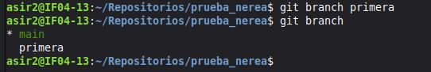
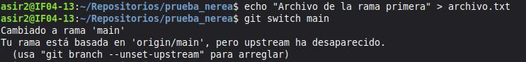
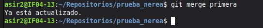
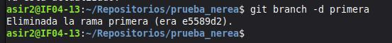
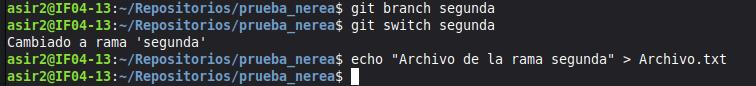
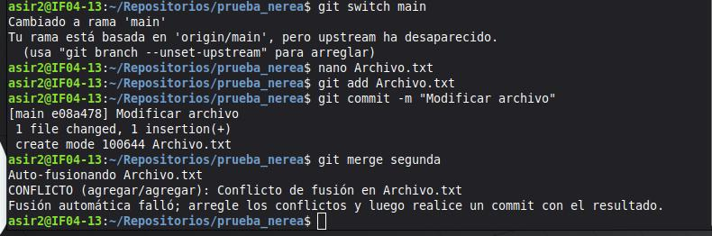
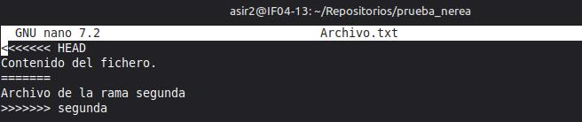
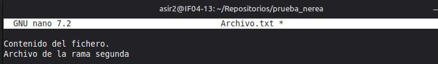
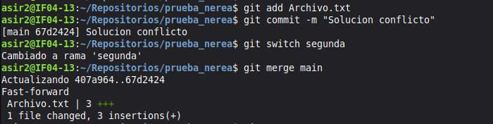
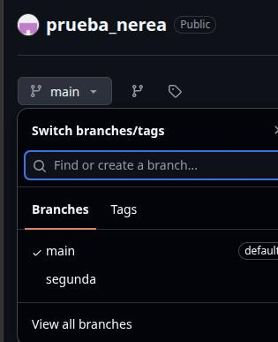

# Ejercicio 3: Trabajando con ramas y uniones.
## En este archivo Markdown están documentados los pasos del ejercicio 1 del Ejercicio 3.

## Crear una rama que se llame primera.
En el repositorio local **prueba_nerea** he creado la rama primera con el comando `git branch "nombre de la rama"`, después, con el comando `git branch` verifico que se haya creado correctamente.



## Crear un fichero en la rama primera y fusionarlo con la main.
Para crear el fichero utilicé el comando `echo`, seguido del contenido del fichero para redirigir la salida a un archivo de texto plano.  
No se ha producido un conflicto porque el archivo fue creado originalmente en la rama primera **no existe** en la rama main, que es la principal.
  

Después, con el comando `git merge`y el nombre de la rama se fusionan ambas ramas.


## Borrar la rama.
```
git branch -d
```
es el comando para eliminar la rama primera que se creó en los ejercicios anteriores.


## Crea una rama que se llame segunda y modifica un fichero para producir un conflicto.
Para producir un conflicto de colisión entre dos archivos al fusionar dos ramas, primero debe crearse otra rama y modificar en ella uno de los archivos del repositorio.

  
Seguidamente, se fusionan ambas ramas para producir el conflicto de colisión entre ambos archivos. Cambio a la rama primera y modifico el fichero para después fusionarlo con la rama segunda, donde ya existía el archivo previamente. Al fusionar ambas ramas, se produce un conflicto de colisión entre los archivos.
  
El contenido del fichero que ha sufrido el conflicto se ve de la siguiente manera: 


## Soluciona el conflicto y sincroniza la rama segunda en el repositorio. Verifica en GitHub que se ha creado la rama en el repositorio.
Para solucionar el conflicto entre los dos archivos, se debe modificar el fichero al que se le han añadido los caracteres especiales y guardarlo. 
  
Finalmente, basta con hacer un `git add` del fichero modificado y un `git commit` para modificar los cambios. Cambio a la rama **segunda** y la fusiono con la main.

  

## Verificación en GitHub.
En esta captura refleja la verificación de que la rama segunda se creó exitosamente en el repositorio remoto en GitHub.
  