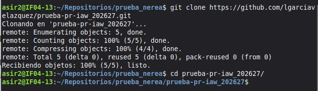
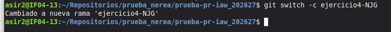
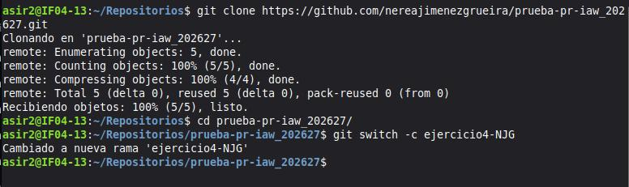
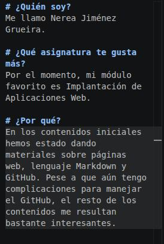
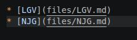
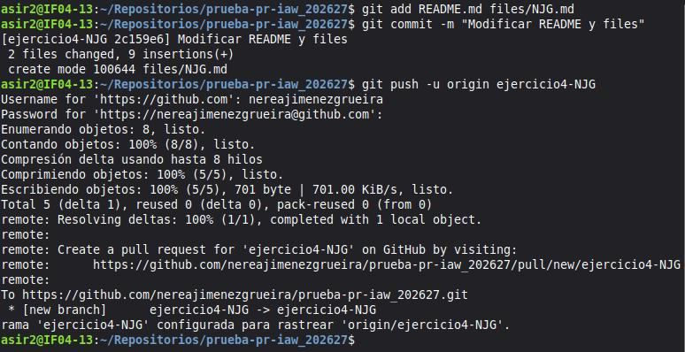
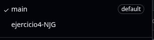
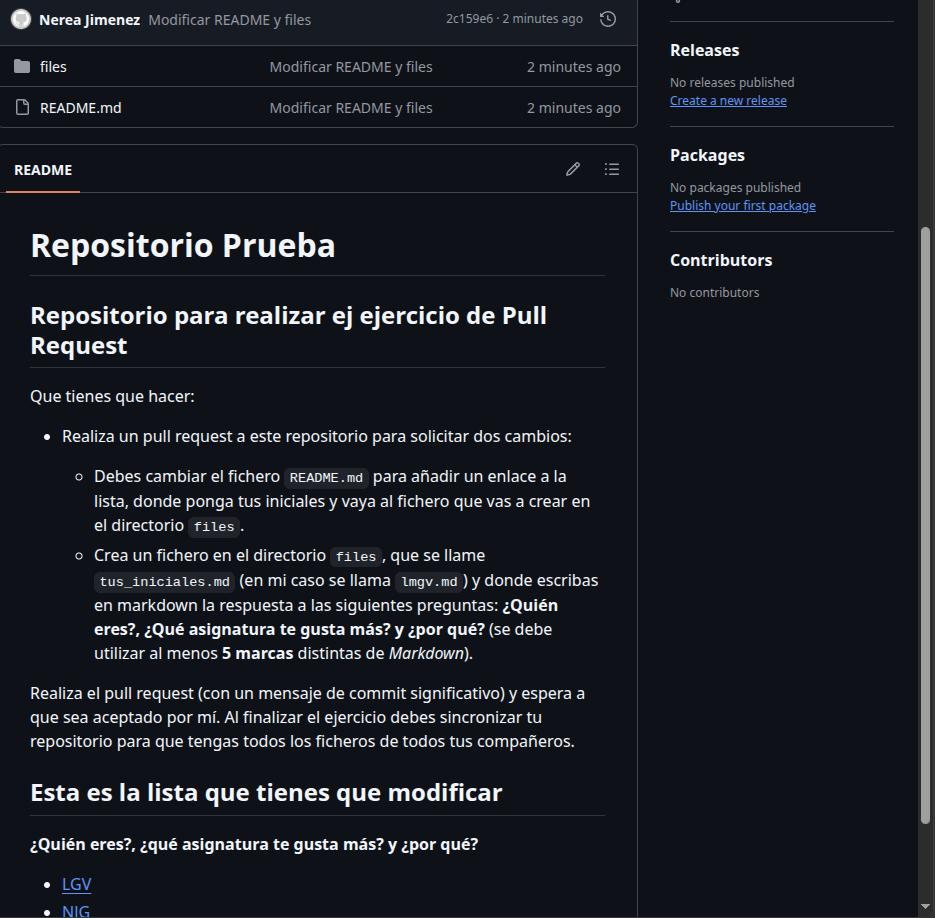
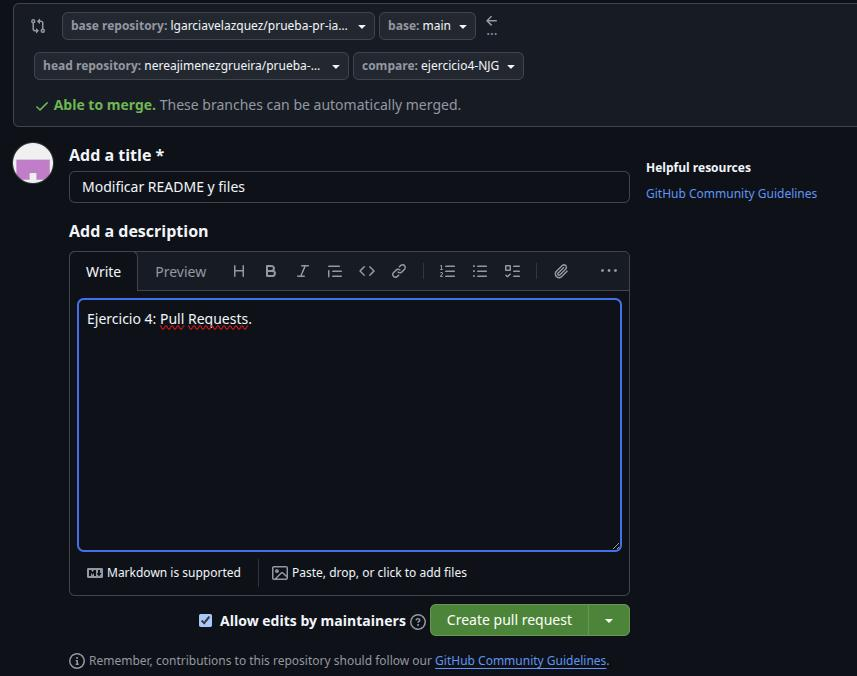

# Ejercicio 4: ¿Cómo colaborar en un proyecto de software libre? ¿Qué es un Pull Request (PR)?

El primer paso consta de clonar el repositorio original del profesor con el comando `git clone`.

Creo la rama con mis iniciales para agregar en ella los cambios en los ficheros que contiene el repositorio original.

En la página de GitHub, accedo al repositorio del profesor y localizo el botón "Fork". Creo uno y después lo clono en mi equipo local mediante `git clone`. Después creo la misma rama que creé anteriormente.

En el repositorio clonado, modifico el archivo "Files" para agregar un enlace al README que modifico después, respondiendo a las preguntas solicitadas.

Subo los cambios con `git push`y el nombre de la rama con mis iniciales.

Después de haber subido los cambios, entro a GitHub y en el repositorio clonado verifico que se haya creado la rama correctamente. Debe tener dos ramas, la **main**, que es la que contiene los archivos originales del profesor y la **ejercicio4-NJG**, que contiene mis archivos modificados y el enlace al README.

Finalmente, creo el Pull Request en el botón superior que dice **Compare and Pull Request**. Le agrego una descripción y lo creo.

